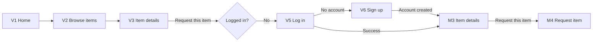
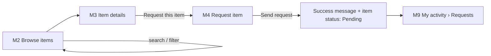
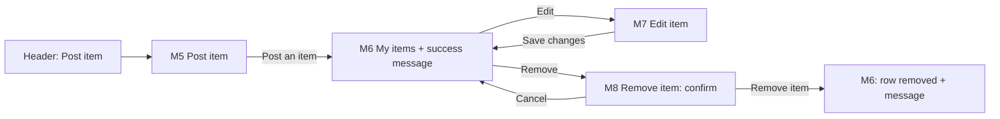
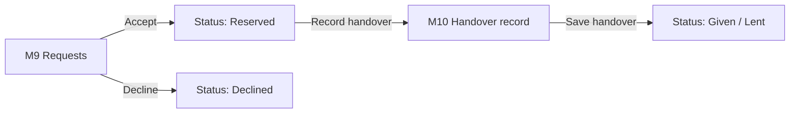
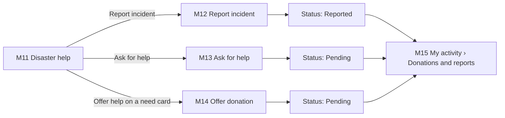
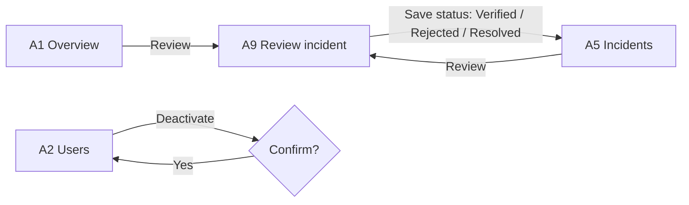

# Circlo — UI/UX Design Document (Final Design Reference)

**Project:** Circlo, a community web system for sharing reusable items and organizing donations after disasters
**Course:** WS 101, Web System
**Version:** 1.0 (design freeze candidate), 27 November 2026
**Build target:** HTML + CSS (+ small JavaScript for CRUD and interactions), desktop first

> **Purpose of this document:** every developer builds from the same rules, so no page invents its own interface.
> If you need something that is not in this document, **do not improvise**. Add it to the *Design questions* list (section 12) and ask the design owner.

---

## Table of contents

1. [How to use this document](#1-how-to-use-this-document)
2. [Users, scope and principles](#2-users-scope-and-principles)
3. [Information architecture and page catalog](#3-information-architecture-and-page-catalog)
4. [User flows](#4-user-flows)
5. [Design system (tokens)](#5-design-system-tokens)
6. [Layout system and page templates](#6-layout-system-and-page-templates)
7. [Components](#7-components)
8. [Wireframes](#8-wireframes)
9. [Interaction, states and feedback](#9-interaction-states-and-feedback)
10. [Responsive behavior](#10-responsive-behavior)
11. [Accessibility and content rules](#11-accessibility-and-content-rules)
12. [Build conventions, definition of done and open questions](#12-build-conventions-definition-of-done-and-open-questions)

---

## 1. How to use this document

| Question | Where to look |
|---|---|
| What colour, font size or spacing do I use? | Section 5 (tokens). Never hard-code a hex value or pixel size that is not a token. |
| How is my page laid out? | Section 6 (templates) and section 8 (wireframes) |
| How does this button, card, table or form field look and behave? | Section 7 (components) |
| Which header tab is active on my page? What is the main button? | Section 3.3 (page catalog) |
| What happens after the user clicks or submits? | Sections 4 and 9 |

**Source of truth order**

1. This document, for rules, tokens, class names and behaviour.
2. Figma, for exact visuals and copy on each screen.
3. If the two disagree, stop and log it in *Design questions* (section 12.4). Don't pick one yourself.

---

## 2. Users, scope and principles

### 2.1 Users (roles)

| Role | Can do | Header |
|---|---|---|
| **Visitor** (not logged in) | Browse items and needs, view details, log in, sign up | Visitor header |
| **Member** | Everything a visitor can, plus post, request, edit and remove items; record handovers; report incidents; ask for help; offer donations | Member header |
| **Admin** | Manage users, categories, item listings, incidents, assistance requests, donation offers; view the activity log | Admin header + Admin sidebar |

### 2.2 Scope (from the requirements interview)

- Visitors can browse items and needs without an account. They must log in to request, post or donate.
- **Main device: laptop or desktop.** Design width is **1440 px**. Phone layout is out of scope (section 10 defines the minimum fallback).
- Front-end scope: all screens for visitors, members and admins (31 screens).
- Required: full **CRUD**, built with clean, user-friendly **HTML and CSS**.

### 2.3 Design principles

1. **Two features, two colours.** Green means everyday sharing. Orange (amber) means disaster help. Red means high urgency and destructive actions. Never mix them.
2. **One main button per screen**, labelled with its action ("Post an item", not "Submit").
3. **Same heading pattern everywhere:** small uppercase eyebrow label → heading → one short sentence.
4. **Status is always written in words** (Available, Reserved, Pending, Verified…), never shown by colour alone.
5. **Errors sit next to the field.** Users **confirm before removing** anything.
6. **Short copy:** one sentence of explanation per section.

---

## 3. Information architecture and page catalog

### 3.1 Site map

```
Circlo
├── Visitor (public)
│   ├── V1 Home
│   ├── V2 Browse items ──► V3 Item details
│   ├── V4 Disaster help
│   ├── V5 Log in
│   └── V6 Sign up
├── Member (logged in)
│   ├── M1 Home
│   ├── Browse items: M2 Browse ─► M3 Item details ─► M4 Request item
│   ├── Disaster help: M11 Disaster help ─► M12 Report incident
│   │                                    ├► M13 Ask for help
│   │                                    └► M14 Offer donation
│   ├── My activity (tabs)
│   │   ├── M6 My items ─► M7 Edit item / M8 Remove item
│   │   ├── M9 Requests ─► M10 Handover record
│   │   ├── (Handovers)
│   │   └── M15 Donations and reports
│   ├── M5 Post item (from the header "Post item" button)
│   └── M16 No access (shown when a member opens an admin page)
└── Admin (logged in, admin role)
    ├── A1 Overview (dashboard)
    ├── A2 Users
    ├── A3 Categories
    ├── A4 Item listings
    ├── A5 Incidents ─► A9 Review incident
    ├── A6 Assistance requests
    ├── A7 Donation offers
    └── A8 Activity log
```

### 3.2 Suggested file structure

```
circlo/
├── index.html                 (V1 visitor home)
├── browse.html                (V2)
├── item.html                  (V3)
├── disaster-help.html         (V4)
├── login.html                 (V5)
├── signup.html                (V6)
├── member/
│   ├── home.html              (M1)
│   ├── browse.html            (M2)
│   ├── item.html              (M3)
│   ├── request-item.html      (M4)
│   ├── post-item.html         (M5)
│   ├── my-items.html          (M6)
│   ├── edit-item.html         (M7)
│   ├── remove-item.html       (M8)
│   ├── requests.html          (M9)
│   ├── handover.html          (M10)
│   ├── disaster-help.html     (M11)
│   ├── report-incident.html   (M12)
│   ├── ask-for-help.html      (M13)
│   ├── offer-donation.html    (M14)
│   ├── donations-reports.html (M15)
│   └── no-access.html         (M16)
├── admin/
│   ├── index.html             (A1 Overview)
│   ├── users.html             (A2)
│   ├── categories.html        (A3)
│   ├── listings.html          (A4)
│   ├── incidents.html         (A5)
│   ├── assistance.html        (A6)
│   ├── donations.html         (A7)
│   ├── activity-log.html      (A8)
│   └── review-incident.html   (A9)
├── css/
│   ├── tokens.css             (section 5 — variables only)
│   ├── base.css               (reset, typography, links, focus)
│   ├── layout.css             (containers, grids, templates)
│   ├── components.css         (section 7 — every shared component)
│   └── pages/                 (page-only tweaks; keep these tiny)
├── js/
└── assets/
    ├── logo/                  (logo-on-light.svg, logo-on-dark.svg)
    ├── images/
    └── icons/
```

**Rule:** a page links `tokens.css`, `base.css`, `layout.css` and `components.css` in that order. A page-only CSS file is allowed only for layout tweaks, never for new colours, fonts or component styles.

### 3.3 Page catalog

**Header state** = which header link shows the active (green pill) state on that page.

#### Visitor

| ID | Page | Template | Header state | Eyebrow label | Main action | CRUD |
|---|---|---|---|---|---|---|
| V1 | Home | Marketing | Home | — | Sign up / Browse items (hero) | Read |
| V2 | Browse items | List (grid) | Browse items | Everyday sharing | — (filters, cards) | Read |
| V3 | Item details | Detail | Browse items | Everyday sharing | Request this item → login | Read |
| V4 | Disaster help | List (needs) | Disaster help | Disaster help | Offer help → login | Read |
| V5 | Log in | Auth form | none | — | Log in | — |
| V6 | Sign up | Auth form | none | — | Create account | Create |

#### Member

| ID | Page | Template | Header state | Eyebrow label | Main action | CRUD |
|---|---|---|---|---|---|---|
| M1 | Home | Member home | Home | — | Quick actions | Read |
| M2 | Browse items | List (grid) | Browse items | Everyday sharing | — | Read |
| M3 | Item details | Detail | Browse items | Everyday sharing | Request this item | Read |
| M4 | Request item | Form | Browse items | Everyday sharing | Send request | Create |
| M5 | Post item | Form | My activity | My activity | Post an item | Create |
| M6 | My items | Tabbed table | My activity (tab: My items) | My activity | Post item | Read |
| M7 | Edit item | Form | My activity | My activity | Save changes | Update |
| M8 | Remove item | Confirm | My activity | My activity | Remove item (Danger) | Delete (soft) |
| M9 | Requests | Tabbed table | My activity (tab: Requests) | My activity | — | Read / Update |
| M10 | Handover record | Form | My activity (tab: Handovers) | My activity | Save handover | Update |
| M11 | Disaster help | List (needs) | Disaster help | Disaster help | Report incident (Amber) | Read |
| M12 | Report incident | Form | Disaster help | Disaster help | Report incident | Create |
| M13 | Ask for help | Form | Disaster help | Disaster help | Send request for help | Create |
| M14 | Offer donation | Form | Disaster help | Disaster help | Offer donation | Create |
| M15 | Donations and reports | Tabbed table | My activity (tab: Donations and reports) | My activity | — | Read |
| M16 | No access | Message | none | — | Go to home | — |

#### Admin

All admin pages use the **Admin template** (header + sidebar). In the header, **no top link is active**. The sidebar shows the current page.

| ID | Page | Sidebar active | Main action | CRUD |
|---|---|---|---|---|
| A1 | Overview | Overview | — (stat cards, incidents waiting) | Read |
| A2 | Users | Users | — (row actions: Edit, Deactivate) | Read / Update / Delete (deactivate) |
| A3 | Categories | Categories | Add category | Create / Read / Update / Delete |
| A4 | Item listings | Item listings | — (row actions: View, Hide) | Read / Update |
| A5 | Incidents | Incidents | — (row action: Review) | Read |
| A6 | Assistance requests | Assistance requests | — | Read / Update |
| A7 | Donation offers | Donation offers | — | Read / Update |
| A8 | Activity log | Activity log | — | Read |
| A9 | Review incident | Incidents | Save status | Update |

### 3.4 CRUD coverage

| Action | Where |
|---|---|
| **Create** | Sign up, Post item, Request item, Report incident, Ask for help, Offer donation, Add category (admin) |
| **Read** | Browse items, Item details, Disaster help, My items, Requests, admin lists, Activity log |
| **Update** | Edit item, Handover record, Review incident status, Edit user or category (admin) |
| **Delete** | Remove item (**soft delete**: hidden, record kept), Deactivate user, Remove category (admin) |

---

## 4. User flows

> Flows are written in Mermaid, which renders on GitHub. Each box is a page or a decision.

### 4.1 Visitor → member (gatekeeping)



**Rule:** when a visitor tries a member-only action, send them to Log in and **return them to the page they came from** after they log in.

### 4.2 Request an item (test task 1: "Find a study table and request it")



### 4.3 Post, edit and remove an item (member CRUD)



### 4.4 Handover (owner side)



### 4.5 Disaster help (test tasks 2 and 3)



### 4.6 Admin review



### 4.7 Access control

| Situation | Result |
|---|---|
| Visitor opens a member page | Redirect to V5 Log in, then back |
| Member opens an admin page | Show M16 No access |
| Any user clicks Log out | Go to V1 Home with the visitor header |

---

## 5. Design system (tokens)

Put **all** of these in `css/tokens.css`. Components and pages use only these variables.

### 5.1 Colour

```css
:root {
  /* Brand and roles */
  --color-primary:        #166534; /* main buttons, links, everyday sharing */
  --color-primary-hover:  #14532D;
  --color-needs:          #B45309; /* disaster help buttons and labels (white text 5.0:1) */
  --color-needs-hover:    #92400E;
  --color-danger:         #B91C1C; /* high urgency, errors, remove actions */
  --color-danger-hover:   #991B1B;

  /* Surfaces */
  --color-bg:             #FAFAF9; /* page background */
  --color-surface:        #FFFFFF; /* cards, header, tables, inputs */
  --color-surface-soft:   #F0FDF4; /* green sections, hero, active nav pill, table header */
  --color-needs-soft:     #FFF7ED; /* disaster sections */
  --color-danger-soft:    #FEF2F2; /* error backgrounds (use sparingly) */

  /* Text and lines */
  --color-text:           #1C1917;
  --color-text-muted:     #57534E;
  --color-text-on-color:  #FFFFFF;
  --color-border:         #D6D3D1;

  /* Logo only — never use for UI */
  --color-logo-green:     #216339;
  --color-logo-orange:    #E78218;
}
```

**Colour rules**

| Meaning | Colour |
|---|---|
| Everyday sharing (items, my activity, admin) | Primary green |
| Disaster help (incidents, needs, donations) | Needs amber, on Needs soft backgrounds |
| High urgency, errors, remove/deactivate | Danger red |
| Neutral information | Text muted on white |

**Contrast (checked):** white on amber 5.0:1, amber text on Needs soft 4.7:1, body text on background about 7:1 or more. Don't put muted text on coloured backgrounds.

### 5.2 Typography

Fonts (Google Fonts):
- **Headings:** Bricolage Grotesque SemiBold (600)
- **Body and UI:** Atkinson Hyperlegible Regular (400) and Bold (700)

```css
:root {
  --font-heading: "Bricolage Grotesque", system-ui, sans-serif;
  --font-body:    "Atkinson Hyperlegible", system-ui, sans-serif;
}
```

| Token | Use | Font | Size / line height | Weight |
|---|---|---|---|---|
| `--text-display` | Home hero headline only | Heading | 56 / 64 px, letter-spacing −0.02em | 600 |
| `--text-h1` | Page title (one per page) | Heading | 36 / 44 px | 600 |
| `--text-h2` | Section title | Heading | 28 / 36 px | 600 |
| `--text-h3` | Card and panel titles | Heading | 20 / 28 px | 600 |
| `--text-stat` | Stat card numbers | Heading | 40 / 48 px | 600 |
| `--text-lead` | The one-sentence intro under a heading | Body | 18 / 28 px | 400 |
| `--text-body` | Default text, form inputs, nav links | Body | 16 / 24 px | 400 |
| `--text-small` | Table cells, meta lines, helper text | Body | 14 / 20 px | 400 |
| `--text-eyebrow` | Uppercase label above headings | Body | 13 / 16 px, uppercase, letter-spacing 0.08em | 700 |
| `--text-button` | Buttons, active nav | Body | 16 / 24 px | 700 |

**Heading pattern (use on every page and home section):**

```html
<header class="page-head">
  <p class="eyebrow">My activity</p>          <!-- green, or amber for Disaster help -->
  <h1>My activity</h1>
  <p class="lead">See and manage the items you shared.</p>
</header>
```

Eyebrow colours: **Everyday sharing / My activity / Admin → green**, **Disaster help → amber**.

### 5.3 Spacing (8 px grid)

```css
:root {
  --space-1: 4px;   --space-2: 8px;   --space-3: 12px;  --space-4: 16px;
  --space-5: 20px;  --space-6: 24px;  --space-8: 32px;  --space-10: 40px;
  --space-12: 48px; --space-16: 64px; --space-20: 80px; --space-24: 96px;
}
```

| Use | Token |
|---|---|
| Gap inside a component (icon to label, label to input) | `--space-1` to `--space-2` |
| Card padding | `--space-4` (16) to `--space-6` (24) |
| Gap between cards | `--space-6` (24) |
| Heading block to content | `--space-8` (32) |
| Between page sections | `--space-16` (64) on marketing pages, `--space-10` (40) on app pages |
| Page side padding (desktop) | `--space-20` (80) |

### 5.4 Radius, borders, shadows, sizes

```css
:root {
  --radius-sm: 6px;    /* badges */
  --radius-md: 8px;    /* buttons, inputs, nav pills */
  --radius-lg: 12px;   /* cards, tables, panels */
  --radius-xl: 20px;   /* V1 hero photo, feature panels, call-to-action panel */
  --radius-full: 999px;
  /* Also in tokens.css since the Nov 2026 redesign: --shadow-float,
     --ease-out, --duration-fast / -press / -enter, and
     --color-on-dark-muted / -line / -soft for text and lines on green. */

  --border: 1px solid var(--color-border);
  --shadow-card: 0 1px 2px rgba(28, 25, 23, 0.06);
  --shadow-raised: 0 4px 12px rgba(28, 25, 23, 0.08); /* hover on clickable cards only */

  --header-height: 88px;
  --sidebar-width: 240px;
  --content-max: 1280px;     /* 1440 − 2 × 80 */
  --auth-max: 440px;         /* Auth form card (V5, V6) */
  --form-max: 640px;         /* Form template column */
  --confirm-max: 560px;      /* Confirm panel (M8) */
  --field-max: 400px;        /* Field width in forms */
  --icon-size: 20px;         /* Icons, radios and checkboxes */
  --control-height: 48px;    /* buttons and inputs */
  --tap-min: 44px;           /* minimum click area for links */

  --focus-ring: 0 0 0 3px #FFFFFF, 0 0 0 5px var(--color-primary);
}
```

### 5.5 Icons and images

- **Icons:** one outline icon set at 20 px with a 1.5 px stroke (the admin sidebar style). Icons are decorative (`aria-hidden="true"`) when next to a text label.
- **Logo:** `logo-on-light.svg` in headers, `logo-on-dark.svg` in the green footer. The mark is 30 px with "Circlo" text beside it.
- **Item photos:** `object-fit: cover`, rounded to match the card top. Until real photos exist, use a neutral placeholder with alt text "Photo coming soon". **Every image needs alt text.**

---

## 6. Layout system and page templates

### 6.1 Grid

- Design canvas: **1440 px**. Content container: **max 1280 px**, centred, 80 px side padding.
- **Item grid:** 4 columns × 302 px, 24 px gap (4 × 302 + 3 × 24 = 1280).
- **Need grid:** 3 columns × 400 px, 40 px gap.
- **Stat cards (admin):** 4 equal columns, 16 px gap.
- Use CSS Grid for page grids and Flexbox inside components.

```css
.container   { max-width: var(--content-max); margin-inline: auto; padding-inline: var(--space-20); box-sizing: content-box; }
.grid-items  { display: grid; grid-template-columns: repeat(4, 1fr); gap: var(--space-6); }
.grid-needs  { display: grid; grid-template-columns: repeat(3, 1fr); gap: var(--space-10); }
.grid-stats  { display: grid; grid-template-columns: repeat(4, 1fr); gap: var(--space-4); }
```

### 6.2 Templates

Every page uses exactly one of these templates.

| Template | Used by | Structure |
|---|---|---|
| **Marketing** | V1 | Header → full-width sections (hero, feature blocks, bands) → Footer |
| **Member home** | M1 | Header → welcome (eyebrow + h1 + summary sentence, no photo) → dashboard [`.member-sidebar` 272 px · main: 4 stat cards → "Incoming item requests" panel (table) → two half panels (Needs nearby · Recent updates)] → new items band. No footer. |
| **List** | V2, M2 (grid of item cards); V4, M11 (grid of need cards) | Header → page head → toolbar (search + filters) → grid → pagination → Footer |
| **Detail** | V3, M3 | Header → back link → two columns (photo 7/12, info panel 5/12) → Footer |
| **Form** | M4, M5, M7, M10, M12, M13, M14, A9 | Header → page head → single column form (max 640 px) → actions row → Footer |
| **Auth form** | V5, V6 | Header → centred card (max 440 px) → Footer |
| **Tabbed table** | M6, M9, M15 | Header → page head → tabs → toolbar → table → Footer |
| **Confirm** | M8 | Header → centred panel (max 560 px) with summary, warning and Danger + Secondary buttons → Footer |
| **Message** | M16 | Header → centred icon, heading, sentence, one button → Footer |
| **Admin** | A1–A9 | Header → [Sidebar 240 px | Content (40 px padding)]. No footer. |

---

## 7. Components

Naming convention: **BEM-style classes**, for example `.btn`, `.btn--primary`, `.card__title`, `.is-active`.
Build every component once in `components.css`. Pages **reuse** these classes and never restyle them.

### 7.1 Header (`.site-header`)

**Anatomy:** Logo (left) · Main navigation (centred on the page) · Account area (right)
**Size:** height 88 px, white background, 1 px bottom border, 80 px side padding.

| Role | Main navigation (centre) | Account area (right) |
|---|---|---|
| Visitor | Home · Browse items · Disaster help | Log in (text link) · **Sign up** (Primary button) |
| Member | Home · Browse items · Disaster help | **Post item** (Primary button) · My activity · Log out |
| Admin | Home · Browse items · Disaster help | My activity · Log out |

- **Main navigation is centred on the page**, not between the logo and the account area. Use `position: absolute; left: 50%; transform: translateX(-50%)` or a three-column grid (`1fr auto 1fr`).
- **Nav link:** 44 px tall click area, padding 0 16 px, radius 8 px, gap 8 px, text 16 px, colour Text.
- **Active link:** background Surface soft, text Primary, bold, plus `aria-current="page"`.
- **Hover:** text Primary, underline. **Focus:** focus ring.
- **Log out:** text link in Primary, bold.
- **The admin header has no "Admin dashboard" link** (removed in the final design). Admin pages show **no** active top link, because the sidebar carries the state.
- **The header markup is identical on every page.** Only the role variant and the `aria-current` link change. Copy the same snippet, or inject it with one shared JS file.

```html
<header class="site-header">
  <a class="logo" href="/member/home.html">
    
    <span class="logo__text">Circlo</span>
  </a>
  <nav class="site-nav" aria-label="Main">
    <a class="site-nav__link" href="/member/home.html">Home</a>
    <a class="site-nav__link is-active" aria-current="page" href="/member/browse.html">Browse items</a>
    <a class="site-nav__link" href="/member/disaster-help.html">Disaster help</a>
  </nav>
  <div class="account-nav">
    <a class="btn btn--primary" href="/member/post-item.html">Post item</a>
    <a class="site-nav__link" href="/member/my-items.html">My activity</a>
    <a class="site-nav__link site-nav__link--strong" href="/index.html">Log out</a>
  </div>
</header>
```

> **Visitor active state in code:** in Figma the visitor header has no active variant (the current page was marked with an underline). In the build, **use the same green pill active state for visitors** so all three roles behave the same.

### 7.2 Footer (`.site-footer`)

- Deep green band (Primary hover), white text, `logo-on-dark.svg`, faint Circlo rings in the top-left corner (decorative SVG).
- Four columns: brand (logo + tagline set in the h2 heading style) · "Explore" links · "Your account" links · the required note **"Circlo is not an emergency response service."** in a bordered box with an info icon. Below a thin line: "© 2026 Circlo · A WS 101 community project" and "Back to top ↑".
- Classes: `.site-footer`, `.site-footer__rings`, `__inner`, `__brand`, `__tagline`, `__heading` (uppercase label, an h2), `__nav` (a `<ul>`), `__link`, `__note` (+ `__note-icon`), `__bar`. Muted text and lines on green use `--color-on-dark-muted` / `--color-on-dark-line`. 2 columns on laptop, 1 below 1024 px.
- **Visitor pages only** (V1–V6). Member pages (M1–M16) and admin pages (A1–A9) have **no footer** (decision, 27 Nov 2026).
- Because members have no footer, the note "Circlo is not an emergency response service." appears on member pages that show disaster content, as `.section-note` under the needs (M1, and later M11–M14).

### 7.3 Buttons (`.btn`)

| Variant | Class | Background | Text | Border | Hover | Use |
|---|---|---|---|---|---|---|
| Primary | `.btn--primary` | Primary | White | none | Primary hover | Main action on everyday pages |
| Amber | `.btn--amber` | Needs | White | none | Needs hover | Main action on disaster pages |
| Secondary | `.btn--secondary` | White | Primary | 1.5 px Primary | Surface soft bg | Second action, Cancel |
| Danger | `.btn--danger` | Danger | White | none | Danger hover | Remove, Deactivate (always after confirm) |
| Text link | `.link` | none | Primary | none | underline | Row actions (Edit, Review) |
| Light | `.btn--light` | White | Primary | none | Surface soft bg | The one button on a green panel (home call-to-action) |
| Small (size) | `.btn--sm` | — | — | — | — | Row buttons in the M1 requests table. 44 px tall, 14 px text. |

- **Exception (M1 dashboard, Nov 2026 redesign):** each Pending row in "Incoming item requests" has a small Primary **Accept** and a small Secondary **Decline**, as in the reference design. This is the only place where more than one Primary button shows on a screen.
- **Press feedback:** every enabled button scales to 0.97 on `:active` (160 ms, `--ease-out`). An arrow inside a link or button (`.link__arrow`, `.btn__arrow`) nudges 3 px right on hover.

- **Size:** height 48 px, padding 0 20 px, radius 8 px, 16 px bold text. An optional icon (20 px) goes before the label with an 8 px gap.
- **States:** hover (darker), focus (focus ring), active (no movement, a slightly darker shade), disabled (background Border, text muted, `cursor: not-allowed`), loading (label "Saving…", disabled).
- **Labels are verbs that say what happens:** "Post an item", "Send request", "Save changes", "Remove item". Never "Submit" or "OK".
- **Only one Primary or Amber button per screen.** Other buttons are Secondary or text links.
- Use `<button>` for actions and `<a>` for navigation.

### 7.4 Status badge (`.badge`)

| Variant | Class | Colours | Status words that use it |
|---|---|---|---|
| Success | `.badge--success` | green text on Surface soft | Available, Verified, Completed, Resolved, Active |
| Warning | `.badge--warning` | amber text on Needs soft | Reserved, Pending, Medium urgency |
| Neutral | `.badge--neutral` | muted text on #F5F5F4 | Given, Lent, Reported, Closed, Hidden |
| Danger | `.badge--danger` | white on Danger | High urgency, Rejected, Deactivated |

- Height 30 px, padding 0 10 px, radius 6 px, 14 px bold text.
- **Always contains the status word.** Never use a coloured dot alone.

### 7.5 Form field (`.field`)

| Variant | Description |
|---|---|
| Default | Label above (16 px bold), 4 px gap, input 48 px tall, 1 px Border, radius 8 px, white |
| Error | Border Danger 2 px, error message below in Danger 14 px with an icon, `aria-invalid="true"`, message linked with `aria-describedby` |
| Long | `<textarea>`, minimum 120 px tall, resizable vertically |

- Field width: **400 px** in forms (or full width of the 640 px form column for long text).
- Optional helper text below in muted 14 px. Mark required fields with "(required)" in the label, not with a red star only.
- Focus: Primary border plus the focus ring.
- Gap between fields: 24 px. Group related fields with a `<fieldset>` and a `<legend>` (h3 style).
- Select, file upload, radio and checkbox controls follow the same label, border, radius and focus rules.
- Classes: the form is `.form` (column, max `--form-max`, 24 px gap; each `.field` max `--field-max`, `.field--long` uses the full column). A radio group is `<fieldset class="field field--group">` with `<legend class="field__legend">` (label style) and `.field__choices` holding `<label class="choice"><input type="radio"> To give</label>` (20 px control, 44 px tall). The buttons sit in `.form__actions` (main button, then Cancel as Secondary).

```html
<div class="field field--error">
  <label for="title" class="field__label">Item name (required)</label>
  <input id="title" class="field__input" aria-invalid="true" aria-describedby="title-error">
  <p id="title-error" class="field__error">Enter a name for your item.</p>
</div>
```

### 7.6 Item card (`.item-card`)

- Size: 302 × about 268 px, white, 1 px Border, radius 12 px, shadow-card.
- **Anatomy:** photo (top, about 150 px tall, cover) → body (16 px padding): title (h3, 18–20 px) → meta line in muted 14 px ("To give · Zone 3") → status badge.
- The whole card is one link to the item details page. Hover: shadow-raised and title underline.
- Title max 2 lines, then ellipsis.
- **Row variant** (`.item-card--row`): photo on the left (35%, 4:3), text on the right. Used above the M4 request form inside `.form-context`.

### 7.7 Need card (`.need-card`)

- Size: 400 × about 198 px, white with a 4 px amber top or left accent, 1 px Border, radius 12 px.
- **Anatomy:** urgency badge (High = Danger, Medium = Warning, Low = Neutral) → title (h3) → details on one line separated by " · ": **"Flood · 20 people affected · Needs 40 containers"** → Amber button "Offer help".
- Shown on Needs soft section backgrounds or plain background.

### 7.8 Tabs (`.tabs`) — My activity

- Tabs: **My items · Requests · Handovers · Donations and reports**.
- Text 16 px, 24 px gap. Active tab: Primary, bold, 2 px underline, `aria-current="page"` (tabs are links to separate pages).
- Sits below the page head and above the toolbar, with a 1 px Border line under the whole row.
- Markup: `<nav class="tabs" aria-label="My activity"><ul class="tabs__list"><li><a class="tabs__link" aria-current="page">`. Click area 44 px tall.

### 7.9 Table (`.table`)

- Container: white, 1 px Border, radius 12 px, overflow hidden.
- **Header row:** Surface soft background, 14 px bold, 49 px tall, 16 px cell padding.
- **Body rows:** 49 px tall minimum, 14 px text, 1 px Border between rows. Hover background #FAFAF9.
- **Actions column (last):** text links. Edit/Review in Primary, Remove/Deactivate in Danger. Space them 16 px apart.
- Status column uses the badge component or a status select.
- Use real `<table>`, `<thead>`, `<th scope="col">`.
- **Empty state:** one row spanning all columns, with a sentence and a button where it helps ("You haven't posted any items yet." + "Post an item").
- Classes: `.table-wrap` (white container, border, radius; scrolls sideways on small windows) → `table.table` with a visually hidden `<caption>`. `.table__primary` (bold first cell), `.table__actions` (row links 16 px apart; Remove uses `.link .link--danger`), `.table__empty` (empty-state cell, `colspan` = all columns). A status select in a row is a `.field__input` (44 px tall in tables) with a visually hidden label ("Status of Study table"). A row action that changes data (Accept, Decline) is a `<button class="link">` inside its own small POST `<form>`, with an `aria-label` naming the row ("Accept Ana Cruz's request for your Electric fan"). `.table__note` is muted cell text (request message, "No action needed"). Two tables on one page each get a `.page-head` with an h2 above them.

### 7.10 Admin sidebar (`.admin-sidebar`)

- Width 240 px, white, 1 px right border, full height below the header, 16 px padding.
- Items (in order): **Overview, Users, Categories, Item listings, Incidents, Assistance requests, Donation offers, Activity log**.
- Each item: 40 px tall, 20 px icon + 12 px gap + label 16 px, radius 8 px.
- **Active item:** Surface soft background, Primary bold text, **green icon**, `aria-current="page"`.
- Hover: #FAFAF9 background, Primary text.
- Built: `<aside class="admin-sidebar" aria-label="Admin"><nav aria-label="Admin pages"><ul class="admin-sidebar__list">` → `.admin-sidebar__link` with `.admin-sidebar__icon` (20 px outline SVG, `aria-hidden`). Links are **44 px** tall, not 40 px, to meet the click-area rule (11.1). Layout: `.admin-layout` (grid: `--sidebar-width` | content) and `<main class="admin-content">` (40 px padding), in layout.css. Below 1024 px the sidebar becomes a horizontal, scrollable row above the content.

### 7.11 Stat card (`.stat-card`)

- About 270 × 118 px, white, 1 px Border, radius 12 px, padding 20 px.
- Number in `--text-stat` Primary, label below in 14 px muted ("User accounts").
- Classes: `.stat-card`, `.stat-card__number`, `.stat-card__label`, inside `ul.grid-stats`.
- **Edge variant (M1):** `a.stat-card.stat-card--edge` is a link to its My activity page: 3 px top edge in Primary (`.stat-card--needs`: Needs amber for donation offers), the label first as an uppercase eyebrow, the number in Text colour, then `.stat-card__note` ("See my items →"). Hover: shadow-raised and a 2 px lift.

### 7.12 Supporting components

| Component | Spec |
|---|---|
| **Page head** (`.page-head`) | Eyebrow → H1 → lead. 32 px below it before content. With buttons on the right: `.page-head--split`, text in `.page-head__text`, buttons in `.page-head__actions`. |
| **Toolbar** (`.toolbar`) | Search input (left, 400 px) + filter selects + optional button (right). 24 px below. Each control is a `.field` with a visible label; the search is `.toolbar__search`, each select is `.toolbar__filter`, an optional button on the right is `.toolbar__action`. Filtering in the front end: `js/list-filter.js` (`data-filter-form`, `data-filter-list`; mark `data-filter-text` on the cells to search when a row also holds other words). |
| **Success message after an action** (`js/flash.js`) | Pages that finish Create/Update/Delete send the user to the list with `?done=posted`, `?done=saved` or `?done=removed`. The list page holds one hidden `.alert--success` per word (`data-flash="posted"`, `role="status"`) and the script shows the matching one. |
| **Pagination** (`.pagination`) | Previous · page numbers · Next, 44 px click areas, current page in the active pill style. Links are `.pagination__link`; the current page has `aria-current="page"`; a Previous/Next that can't be used is a `<span>` with `aria-disabled="true"`. |
| **Alert / message** (`.alert`) | Success: Surface soft + green icon. Error: Danger soft + red icon. Info: white + border. Radius 8 px, 16 px padding, text in words. Appears at the top of the content after an action. Classes: `.alert--success`, `.alert--error` (none for Info), `.alert__icon` (20 px SVG, `aria-hidden`), `.alert__body`, `.alert__title` (bold), `.alert__list`. The error summary (9.2, 3+ errors) is an `.alert--error` with `role="alert"` and `data-error-summary`. |
| **Attention list** (`.attention-list`) | M1 "Needs your attention". White panel (1 px Border, radius 12 px). Each `.attention-list__row` (12 px × 24 px padding, 1 px Border between rows): status badge · `.attention-list__text` (sentence + `.attention-list__meta`, muted 14 px, "Request · 26 Nov 2026") · text link ("Review request"). When nothing is waiting, show the empty state "You're all caught up." instead. |
| **Welcome** (`.welcome`) | M1 only, replaces the hero. `.welcome__title` (h1 at `--text-display`, "Welcome back, Maria.") and `.welcome__summary` (20 px sentence whose counts are bold links: "You have 2 requests to answer and 1 report update."). No photo, no background band. |
| **Dashboard layout** (`.dashboard`, layout.css) | M1: two columns, 8/12 + 4/12, 40 px gap, 64 px below; one column below 1024 px. |
| **Action list** (`.action-list`) | M1 "Start something": a stacked list of whole-row links. Each `.action-list__link`: white, 1 px Border, radius 12 px, **4 px left edge** in Primary (sharing) or Needs (`--needs`, disaster help), 20 px outline icon, bold title in the same colour, muted 14 px description. Hover: Surface soft / Needs soft. Links, not buttons, so the header "Post item" stays the only Primary button. |
| **Member sidebar** (`.member-sidebar`, M1) | White card, 272 px (240 on laptop), sticky 24 px from the top, one column below 1024 px. Top: `.profile` (48 px initials circle `.profile__avatar`, `.profile__name`, `.profile__role` "Member · Zone 3" + Active badge). Then two `<nav>`s, each with a `.member-nav__label` (uppercase, muted) and `ul.member-nav__list` of `.member-nav__link` (44 px, 20 px icon `.member-nav__icon`, `.member-nav__text`, optional `.member-nav__count` pill with visually hidden words "2 waiting"). Current link: Surface soft + Primary bold + `aria-current="page"`. Disaster links use `.member-nav__link--needs` (amber). |
| **Panel** (`.panel`) | White card for one dashboard block: 32 px padding (24 px in a half-width `.member-split`), 1 px Border, radius 12 px, shadow-card. Starts with a `.page-head` (split with a "See all →" link). `.panel--needs` adds the 4 px amber top edge. A table or `.attention-list` sits inside. |
| **Person** (`.person`) | Name with a 28 px initials circle (`.person__avatar`, `aria-hidden`), used in the M1 requests table. |
| **Home hero** (`.hero`, V1) | 11/13 split. Left (`data-enter`): `.hero__kicker` pill with a green and an amber dot naming the two features → display h1 with `.hero__title-accent` (green, a hand-drawn amber `.hero__scribble` under it) → muted lead → Primary + Secondary buttons → `ul.hero__stats` (three `.hero__stat` figures). Right (`.hero__visual`): faint `.hero__rings`, the photo (radius 20 px, shadow-float), and two `.hero-preview` cards (`--item`, `--need`) pinned to its corners; they copy cards from further down, so they are `aria-hidden`. |
| **Feature panel** (`.feature-card`, V1) | Tinted panel, radius 20 px, 32 px padding: eyebrow → h3 → muted text → `ul.feature-card__list` (white mini list of three `.feature-card__row`s: 36 px glyph, name + meta, status badge) → link with arrow. |
| **Steps** (`.steps`, V1) | Three columns joined by one dashed line; each `.step__number` is a 48 px outlined circle, the last one filled Primary. Stacks vertically below 1024 px. |
| **Call-to-action panel** (`.cta-band`, V1) | Green panel, radius 20 px, 64 px padding, `.cta-band__text` (h2 at h1 size + lead in on-dark muted) on the left, one `.btn--light` on the right, `.cta-band__rings` behind. |
| **Section note** (`.section-note`) | 14 px text below a section's content, 24 px above it. Used for the emergency note on member pages (7.2). |
| **Form context** (`.form-context`) | What a form is about, shown between the page head and the form at form width, 32 px below. M14 shows the need being answered as a `.need-card` without its button; M4 shows the requested item as an `.item-card--row`. Both sit under a visually hidden h2. |
| **Dialog** (`.dialog`, `js/dialog.js`) | Admin tables confirm or quick-edit in a native `<dialog>` opened with `showModal()`: focus stays inside, Esc closes, and focus returns to the row button. The dialog holds a `.confirm-panel` (red edge for Deactivate/Remove, `.confirm-panel--edit` green edge for Edit/Rename). The row button is `<button type="button" aria-haspopup="dialog" data-dialog="ID" data-id data-name data-value>`; the dialog fills `[data-dialog-name]`, `input[name="id"]` and `[data-dialog-value]` from it. Backdrop: `--color-overlay`. |
| **Detail list** (`.detail-list`) | Label → value pairs in a `<dl>` (bold labels, 2 columns). Used in the A9 report summary, inside an `.info-panel`. |
| **Message panel** (`.message-panel`) | Message template (M16). Centred column, max `--confirm-max`, 64 px above and below: 48 px outline icon in Primary (`.message-panel__icon`, `aria-hidden`) → h1 → `.lead` sentence → one Primary button. |
| **Auth card** (`.auth-card`) | V5 / V6 only. White card, max `--auth-max` (440 px), centred, 32 px padding, 1 px Border, radius 12 px. Inside: `.page-head` (h1 → lead, no eyebrow per 3.3), optional alert, `.auth-card__form` (fields 24 px apart, full-width main button), then `.auth-card__switch` ("No account yet? Sign up"). |
| **Form validation** (`js/form-validate.js`) | Add `data-validate` to a `<form>`. Each field has an error `<p class="field__error" id="ID-error" hidden>` with a 16 px icon (`.field__error-icon`) and `.field__error-text`; the input's `aria-describedby` includes that id. Messages come from `data-error-required`, `data-error-email`, `data-error-minlength` and `data-error-match` on the input. Front-end checks only: the backend checks again. |
| **Confirm panel** (`.confirm-panel`) | Heading "Remove this item?", a summary of what is affected, a sentence on what happens ("It will be hidden from Browse items. The record is kept."), then Danger + Secondary buttons. White card, max `--confirm-max` (560 px), centred, 32 px padding, radius 12 px, **4 px Danger top edge** (destructive). Inside: `.confirm-panel__head` (eyebrow → h1), `.confirm-panel__summary` (soft box: bold `.confirm-panel__item` name · details · status badge), `.lead` sentence, then a `<form class="form__actions">` with the Danger button and Cancel. |
| **Back link** (`.back-link`) | "← Back to Browse items", 14 px, Primary, above the page head on detail and form pages. 44 px click area. |
| **Detail layout** (`.detail`, `.detail-photo`, `.info-panel`) | `.detail` (layout.css) is the two-column grid: 7/12 + 5/12, 40 px gap; 6/6 on laptop; one column below 1024 px. `.detail-photo` is the item photo (4:3, cover, radius 12 px, placeholder background). `.info-panel` is a white card (1 px Border, radius 12 px, 24 px padding, 16 px gap) holding `.info-panel__head` (eyebrow → h1), the badge, details, `.lead` description, `.info-panel__note` (muted 14 px, e.g. "Posted by Maria · 25 Nov 2026") and the main button. |
| **Empty state** (`.empty-state`) | Icon (optional), one sentence, one button. |
| **Screen-reader-only text** (`.visually-hidden`, in `base.css`) | Hides text visually but keeps it for screen readers, for example an h2 that keeps headings in order. |

**App page wrapper:** List, Form, Tabbed table and similar pages put `class="page"` on `<main>` (40 px above and below, section 5.3).

---

## 8. Wireframes

> Low-fidelity layouts at 1440 px. Measurements are in px. Figma has the full visual detail.

### 8.1 Headers

```
VISITOR
┌──────────────────────────────────────────────────────────────────────────────────┐
│ 80 ◉ Circlo            [Home]  Browse items  Disaster help        Log in [Sign up] 80 │ 88
└──────────────────────────────────────────────────────────────────────────────────┘
MEMBER
┌──────────────────────────────────────────────────────────────────────────────────┐
│ ◉ Circlo               Home  [Browse items]  Disaster help  [Post item] My activity Log out │
└──────────────────────────────────────────────────────────────────────────────────┘
ADMIN (on admin pages no top link is active)
┌──────────────────────────────────────────────────────────────────────────────────┐
│ ◉ Circlo               Home  Browse items  Disaster help            My activity  Log out │
└──────────────────────────────────────────────────────────────────────────────────┘
[ ] = active green pill (or Primary button for Sign up / Post item)
```

### 8.2 V1 Visitor home (Marketing template)

```
┌ HEADER ───────────────────────────────────────────────────────────┐
├ HERO (Surface soft) ──────────────────────────────────────────────┤
│  Share what you can.                 ┌─────────────────────────┐  │
│  Find what you need.   (display)     │                         │  │
│  One-sentence subhead.               │     Welcome photo       │  │
│  [Primary CTA] [Secondary CTA]       │      736 × 488          │  │
│  120+ items · 340 neighbors · 8 …    └─────────────────────────┘  │
├ "Two ways to help your circle" ── 2 feature cards (green | amber) ┤
├ "New from your neighbors" ─────── 4 item cards ─ "Browse items →" ┤
├ "Neighbors need help now" (Needs soft band) ─ 3 need cards ───────┤
├ "How it works" ─────────────────── 3 steps (1 · 2 · 3) ───────────┤
├ "Ready to join your circle?" band ─ [Sign up] ────────────────────┤
└ FOOTER (green) ───────────────────────────────────────────────────┘
```

### 8.2b M1 Member home (Member home template)

```
┌ MEMBER HEADER (Home active) ──────────────────────────────────────┐
│ MY ACTIVITY                                                        │
│ Welcome back, Maria.                                  (h1 size)    │
│ You have [2 requests to answer] and [1 report update].             │
│ ┌ sidebar 272 ─────┐ ┌ MY LISTINGS ┐┌ PENDING ┐┌ HANDOVERS ┐┌ DONATION┐│ 3 px top edge
│ │ (MS) Maria Santos│ │ 4           ││ 2       ││ 6         ││ 3 (amb.)││
│ │ Member · [Active]│ │ See my items→││Waiting →││ See →     ││ See →   ││
│ │ MY ACTIVITY      │ └─────────────┘└─────────┘└───────────┘└─────────┘│
│ │ ▣ Overview  (cur)│ ┌ Incoming item requests ────── See all requests → ┐│
│ │ ↓ Incoming    (2)│ │ Item │ Requested by │ Qty │ Message │ Status │ Action ││
│ │ ↑ My outgoing    │ │ Fan  │ (AC) Ana Cruz│ 1   │ "…"     │[Pending]│[Accept][Decline]│
│ │ ⇄ Handovers      │ │ Chairs│(ER) Elena   │ 4   │ "…"     │[Accepted]│[Record handover]│
│ │ ▢ My items       │ └──────────────────────────────────────────────────┘│
│ │ ♡ Donations   (1)│ ┌ Needs nearby (amber edge) ┐ ┌ Recent updates ──┐ │
│ │ QUICK LINKS      │ │ [High] Food containers  Offer help │ │ Report verified [Verified] │
│ │ + Post an item   │ │ … + emergency section note │ │ …                │ │
│ │ △ Report incident│ └───────────────────────────┘ └──────────────────┘ │
│ └──────────────────┘                                                │
├ "New from your neighbors" (Surface soft band) ─ 4 item cards ──────┤
└ (no footer) ───────────────────────────────────────────────────────┘
```

### 8.3 V2 / M2 Browse items (List template)

```
┌ HEADER (Browse items active) ─────────────────────────────────────┐
│ EVERYDAY SHARING                                                  │
│ Browse items                                                      │
│ One-sentence lead.                                                │
│                                                                   │
│ [ Search items…            ] [Category ▾] [Type ▾] [Location ▾]   │
│                                                                   │
│ ┌──────┐ ┌──────┐ ┌──────┐ ┌──────┐   4 × 302, gap 24             │
│ │photo │ │photo │ │photo │ │photo │                               │
│ │Title │ │Title │ │Title │ │Title │                               │
│ │meta  │ │meta  │ │meta  │ │meta  │                               │
│ │badge │ │badge │ │badge │ │badge │                               │
│ └──────┘ └──────┘ └──────┘ └──────┘                               │
│ (more rows)                                                       │
│                    ‹ Previous  1 [2] 3  Next ›                    │
└ FOOTER ───────────────────────────────────────────────────────────┘
```

### 8.4 V3 / M3 Item details (Detail template)

```
│ ← Back to Browse items                                            │
│ ┌───────────────────────────────┐  ┌────────────────────────────┐ │
│ │                               │  │ EVERYDAY SHARING           │ │
│ │        Item photo             │  │ Study table        (h1)    │ │
│ │        (7/12 width)           │  │ [Available]                │ │
│ │                               │  │ To give · Zone 3 · Qty 1   │ │
│ │                               │  │ Description paragraph…     │ │
│ └───────────────────────────────┘  │ Posted by Maria · 2 days   │ │
│                                    │ [Request this item]        │ │
│                                    └────────────────────────────┘ │
```

Visitor version: the button opens Log in (flow 4.1).

### 8.5 Form pages (M4, M5, M7, M10, M12, M13, M14, A9)

```
│ ← Back to My items                                                │
│ MY ACTIVITY                                                       │
│ Post an item                                                      │
│ Tell neighbors what you can share.                                │
│                                                                   │
│ Item name (required)                                              │
│ [______________________________]  400 wide                        │
│ Category (required)                                               │
│ [Select a category          ▾]                                    │
│ Listing type   ( ) To give  ( ) To lend                           │
│ Quantity       [___]                                              │
│ Description                                                       │
│ [__________________________________________]  textarea            │
│ Photo          [Choose file]  helper text                         │
│                                                                   │
│ [Post an item]  [Cancel]        ← main + secondary, left aligned  │
```

Disaster forms (M12–M14) use the "Disaster help" eyebrow in amber and an **Amber** main button.

### 8.6 M6 My activity (Tabbed table template)

```
│ MY ACTIVITY                                                       │
│ My activity                                                       │
│                                                                   │
│ My items   Requests   Handovers   Donations and reports           │
│ ‾‾‾‾‾‾‾‾                                                          │
│ [Post item]                                                       │
│ ┌──────────────────────────────────────────────────────────────┐  │
│ │ Item        │ Listing type │ Qty │ Status      │ Actions     │  │ ← Surface soft
│ ├─────────────┼──────────────┼─────┼─────────────┼─────────────┤  │
│ │ Study table │ To give      │ 1   │ Available ▾ │ Edit Remove │  │
│ │ Electric fan│ To lend      │ 1   │ Reserved ▾  │ Edit Remove │  │
│ └──────────────────────────────────────────────────────────────┘  │
```

> Note: the header already has a "Post item" button, so on My items the page button is the one main action **inside the page content**. Don't add a third.

### 8.7 V4 / M11 Disaster help (List template, needs)

```
│ DISASTER HELP (amber)                                             │
│ Disaster help                                                     │
│ One-sentence lead.                     [Report incident] (Amber)  │
│                                        Ask for help (Secondary)   │
│ [Search…] [Type ▾] [Urgency ▾] [Location ▾]                       │
│ ┌────────────┐ ┌────────────┐ ┌────────────┐  3 × 400, gap 40     │
│ │[High]      │ │[Medium]    │ │[Low]       │                      │
│ │Title       │ │Title       │ │Title       │                      │
│ │Flood · 20 …│ │Fire · 8 …  │ │…           │                      │
│ │[Offer help]│ │[Offer help]│ │[Offer help]│                      │
│ └────────────┘ └────────────┘ └────────────┘                      │
```

### 8.8 M8 Remove item (Confirm template)

```
│            ┌──────────────────────────────────────────┐           │
│            │  Remove this item?                       │           │
│            │  Study table · To give · Available       │           │
│            │  It will be hidden from Browse items.    │           │
│            │  Your record is kept.                    │           │
│            │  [Remove item] (Danger)  [Cancel]        │           │
│            └──────────────────────────────────────────┘           │
```

### 8.9 Admin template (A1 Overview)

```
┌ HEADER (no active link) ──────────────────────────────────────────┐
├──────────────┬────────────────────────────────────────────────────┤
│ ▣ Overview   │ ADMIN                                              │
│ ☺ Users      │ Admin overview                                     │
│ ◇ Categories │ Check what needs your attention.                   │
│ ▢ Item list… │ ┌──────┐ ┌──────┐ ┌──────┐ ┌──────┐  stat cards    │
│ △ Incidents  │ │ 48   │ │ 32   │ │ 5    │ │ 12   │                │
│ ◎ Assistance │ │Users │ │Items │ │Help  │ │Donat.│                │
│ ▤ Donation … │ └──────┘ └──────┘ └──────┘ └──────┘                │
│ ↺ Activity … │ Incidents waiting for review  (h2)                 │
│              │ ┌ table: Type │ Location │ Date │ Status │ Review ┐│
│  240 px      │ └───────────────────────────────────────────────┘ │
└──────────────┴────────────────────────────────────────────────────┘
```

A2–A8 follow the same layout: page head → toolbar (search, filters, and "Add category" on A3) → table.

### 8.10 Auth (V5, V6) and Message (M16)

```
V5 / V6                                M16 No access
┌─────────────────────────┐            ┌──────────────────────────────┐
│ Log in                  │            │        (lock icon)           │
│ One sentence.           │            │  You don't have access to    │
│ Email    [___________]  │            │  this page.                  │
│ Password [___________]  │            │  Only admins can open it.    │
│ [Log in]  (full width)  │            │  [Go to home]                │
│ No account? Sign up     │            └──────────────────────────────┘
└─────────────────────────┘
  card max 440, centred
```

---

## 9. Interaction, states and feedback

### 9.1 Interactive states (every clickable element)

| State | Rule |
|---|---|
| Hover | Colour change or underline. Cards: shadow-raised. Never move or resize layout. |
| Focus (keyboard) | Always visible: `box-shadow: var(--focus-ring)`. Use `:focus-visible`. Never `outline: none` without a replacement. |
| Active / current | Green pill (nav), underline (tabs), Surface soft row (sidebar), plus `aria-current="page"`. |
| Disabled | Muted colours, `cursor: not-allowed`, the `disabled` attribute. |
| Loading | Button label changes ("Saving…") and the button is disabled until done. |

Transitions: 150 ms ease for colour and shadow; 160 ms `--ease-out` (`cubic-bezier(0.23, 1, 0.32, 1)`) for transform. Transforms are limited to: button press (scale 0.97), a 2 px lift on linked item and stat cards (only on devices with a real pointer), and the 3 px arrow nudge. The V1 hero enters once on load (fade + 12 px rise, 640 ms, 60–460 ms stagger, the scribble draws itself); nothing else animates on load or on scroll. Everything is wrapped in `prefers-reduced-motion: no-preference`. Item photo placeholders show a dotted ground with outline rings until real photos exist.

### 9.2 Feedback after actions

| Action | Feedback |
|---|---|
| Create (post, request, report, offer) | Go to the related list and show a success alert: "Your item is posted." |
| Update (edit, handover, status) | Stay or return to the list with a success alert: "Changes saved." |
| Delete (remove, deactivate) | Confirm first (M8 / confirm panel), then an alert: "Item removed." |
| Validation error | Show errors next to each field, keep what the user typed, and move focus to the first error. Add a short summary at the top if there are 3 or more errors. |
| Empty list | Empty state with one sentence and one button. |

### 9.3 Status lifecycle (words to use)

| Object | Statuses |
|---|---|
| Item | Available → Reserved → Given / Lent → (Returned) · Hidden (soft-deleted) |
| Request | Pending → Accepted / Declined → Completed |
| Incident report | Reported → Verified / Rejected → Resolved |
| Assistance request | Pending → In progress → Resolved |
| Donation offer | Pending → Accepted → Delivered |
| User | Active → Deactivated |
| Urgency (needs) | High (Danger) · Medium (Warning) · Low (Neutral) |

---

## 10. Responsive behavior

Circlo is **designed for laptop and desktop** (interview decision). Phone layouts are **out of scope**, but pages must not break on smaller windows.

| Breakpoint | Width | Behaviour |
|---|---|---|
| **Desktop (design)** | ≥ 1280 px | Full layout as in Figma: 80 px side padding, 4-column items, 3-column needs, centred nav. |
| **Laptop** | 1024–1279 px | Side padding 40 px. Item grid 3 columns. Need grid 2 columns. Stat cards 2 × 2. Admin sidebar stays 240 px. Detail page columns 6/6. |
| **Small window (fallback, not designed)** | < 1024 px | Side padding 24 px. Item grid 2 columns, need grid 1 column. Header: main nav moves under the logo row and wraps. Admin sidebar becomes a horizontal, scrollable row above the content. Tables scroll horizontally inside their container (`overflow-x: auto`). Forms go full width. |

```css
@media (max-width: 1279px) { /* laptop */ }
@media (max-width: 1023px) { /* fallback */ }
```

**Rules**
- Build **desktop first** (base styles = 1440 design), then use `max-width` media queries.
- Use `max-width` and `minmax()` instead of fixed widths so things shrink, for example `grid-template-columns: repeat(auto-fill, minmax(260px, 1fr))` if you prefer an automatic grid.
- Text sizes do not change between breakpoints, except the hero display (56 → 44 px below 1024).
- Never hide functionality at smaller sizes. Everything that works on desktop must still be reachable.
- Test at 1440, 1280, 1024 and 800 px wide, and at 200% browser zoom.

---

## 11. Accessibility and content rules

### 11.1 Accessibility (WCAG 2.1 AA)

- Colour contrast: text at least 4.5:1, large text and icons at least 3:1 (the tokens already pass).
- Status and errors are **always in words**, never colour alone.
- Click areas: at least 44 px tall for links in navigation and pagination.
- One `<h1>` per page. Headings in order (h1 → h2 → h3).
- Landmarks: `<header>`, `<nav aria-label="Main">`, `<main>`, `<aside>` (admin sidebar, `aria-label="Admin"`), `<footer>`.
- Add a "Skip to content" link as the first focusable element.
- Every input has a visible `<label>`. Errors use `aria-invalid` and `aria-describedby`.
- Every image has alt text. Decorative images and icons use `alt=""` / `aria-hidden="true"`.
- Everything works with the keyboard alone (Tab, Shift+Tab, Enter, Space, Esc for dialogs).
- Confirmation dialogs (if built as modals) trap focus and return it to the trigger when closed.

### 11.2 Content and copy

- **Tone:** warm, plain, neighbourly. Short sentences. "You" and "your".
- **Headings:** sentence case ("Browse items", not "Browse Items").
- **Buttons:** verb + object ("Post an item", "Offer help", "Save changes").
- **Numbers and details:** separated by " · " ("Flood · 20 people affected · Needs 40 containers").
- **Dates:** "25 Nov 2026".
- **Placeholders are not labels.** Use them only for examples ("e.g. Study table").
- Sample numbers (120+ items, 340 neighbors) are placeholders: use real data or remove them before launch.

---

## 12. Build conventions, definition of done and open questions

### 12.1 CSS conventions

- Only use tokens from section 5. **No new hex colours, font sizes or radii in page files.**
- Class names: BEM (`.block__element--modifier`) and state classes (`.is-active`, `.is-open`, `.has-error`).
- No inline styles. No `!important` (except utility classes, if the team agrees).
- Use `rem` for font sizes in code (16 px = 1 rem). Pixels are fine for borders and shadows.
- Use semantic HTML first. Add ARIA only where HTML can't express it.

### 12.2 Build order

1. `tokens.css`, `base.css`, fonts, logo assets.
2. Shared components: header (3 roles), footer, buttons, badges, form fields, cards, tabs, table, sidebar, stat card, alerts, page head.
3. Templates (section 6.2).
4. Pages by area in parallel: Visitor (V1–V6), Member (M1–M16), Admin (A1–A9).
5. CRUD behaviour, states and feedback (section 9).
6. Accessibility pass and responsive pass (sections 10 and 11).

### 12.3 Definition of done (per page)

- [ ] Matches the Figma screen and this document.
- [ ] Uses one template from section 6.2 and only shared components.
- [ ] Correct header role and active link, with `aria-current="page"` (section 3.3).
- [ ] Heading pattern: eyebrow → h1 → lead.
- [ ] Exactly one main (Primary or Amber) button in the content.
- [ ] All statuses in words, all images with alt text.
- [ ] Works with the keyboard and shows a visible focus ring.
- [ ] Error, empty and success states built where they apply.
- [ ] Checked at 1440, 1280 and 1024 px, and doesn't break at 800 px.
- [ ] No hard-coded colours or font sizes. Reviewed by one teammate before merging.

### 12.4 Design questions

When the design doesn't say what to do, add a row here and ask the design owner. Don't guess. Keep the numbers stable, because code comments refer to them (for example "DESIGN.md 12.4 #4").

| # | Question | Raised by | Status |
|---|---|---|---|
| 1 | **Data storage for CRUD.** Where are users, items, requests, incidents and donations saved? (Likely PHP + MySQL on XAMPP, to be agreed with the backend developer.) | Front-end | Open |
| 2 | **Login and roles.** How does a page know whether the person is a visitor, member or admin, and where does it send them after logging in or out? (Affects the header role and M16 No access.) | Front-end | Open |
| 3 | **Logo files.** Section 3.2 and 7.1 expect `assets/logo/logo-on-light.svg` and `logo-on-dark.svg`. Only a PNG exists, and its checkered background is part of the image, not real transparency. Export both SVGs from Figma. | Front-end | Open |
| 4 | **Hero numbers on V1.** "120+ items shared · 340 neighbors · 8 open needs" are sample numbers. Show real counts from the database, or remove them? | Front-end | Open |
| 5 | **Item photos.** Item cards show "Photo coming soon". Can members upload a photo when they post an item, and what are the size and file type limits? | Front-end | Open |
| 6 | **V4 visitor page-head buttons.** Wireframe 8.7 is shared by V4 and M11 and shows "Report incident" (Amber) and "Ask for help" (Secondary). On V4 they are built as links to Log in. Should visitors see them, or only the "Offer help" buttons on the need cards (section 3.3)? | Front-end | Open |
| 7 | **Disaster help filter values.** The Type (Flood, Fire, Typhoon, Earthquake) and Location (Zone 1–5) options on V4 are samples. What is the real list? | Front-end | Open |
| 8 | **Item categories.** The Category filter on V2 uses sample values (Furniture, Appliances, Kitchen, Clothing, Books and school, Baby and kids, Tools). What is the real list? It should match A3 Categories. | Front-end | Open |
| 9 | **Which item the details page shows.** Every card on V2 links to `item.html`, which shows the Study table sample. How does the page know which item to open (for example `item.php?id=12`)? | Front-end | Open |
| 10 | **Sign-up fields and password rule.** V6 asks for Full name, Email, Password and Confirm password, with a minimum of 8 characters. Do we also need a zone/location, phone number, or agreement to terms? Is there a "Forgot password?" flow on V5? | Front-end | Open |
| 11 | **Where Log in and Sign up go next.** The front-end demo sends both to `member/home.html` (M1), except the test email `admin@circlo.test` on Log in, which opens `admin/index.html` (A1). Also: once an admin opens a member page, the header has no way back to the admin area (7.1 removed "Admin dashboard"). Add an admin-only link, or point the logo at A1 for admins? Flow 4.1 says to return users to the page they came from, and admins should go to `admin/index.html`. How is the return page passed (for example `login.html?next=item.html`)? | Front-end | Open |
| 12 | **Post item fields.** Wireframe 8.5 has no location, but item cards show a zone. M5 adds "Pick-up location (required)" with Zone 1–5, and makes Quantity required (1–99). Confirm both, and the 80-character name and 500-character description limits. | Front-end | Open |
| 13 | **Request badges and Decline.** 7.4 doesn't list Accepted or Declined. M9 uses Success for Accepted (like Completed) and Neutral for Declined (like Closed). Decline is a plain text link with no confirmation, because it isn't a remove. Confirm both. M9 also shows the member's own sent requests in a second table ("Your requests"), since flow 4.2 ends on M9. M15 also uses Success for Delivered and Warning for In progress, which 7.4 doesn't list. | Front-end | Open |
| 14 | **Handover, incident and M15 details.** M10 shows the My activity tabs with Handovers active, and its fields are Handover date (required), Given/Lent (required), Return by (lent only), Where you met and Notes. The Handovers tab opens this form, though it really belongs to one accepted request: should there be a list of handovers instead? M12 asks for Type, Location, Date, People affected (optional), What happened and Photo, and shows the emergency note as an Info alert above the form. M15 shows three read-only tables with no actions column. Confirm these. | Front-end | Open |
| 15 | **Ask for help and Offer donation fields.** M13 asks for What you need, How much, Type of disaster, People in household, Location, Urgency (High/Medium/Low, "High means within a day") and Details. Can members set urgency, or should an admin set it? M14 asks for What you're offering, Quantity (1–999), Drop off / Pick up, Ready from and a Note, under the need card being answered. Confirm these. | Front-end | Open |
| 16 | **Admin pages.** (a) A2 "Edit" changes only the role, in a dialog. Should admins edit names or emails too? (b) Removing a category: what happens to items already in it? The dialog says they keep it. (c) A4 "Hide" has no confirm step, because it can be undone with "Show". (d) A6 and A7 change status with a select and a Save link in each row. (e) The admin header's Home, Browse items, Disaster help and My activity links go to the member pages. (f) Sidebar links are 44 px, not 40 px. Confirm these. | Front-end | Open |
| 17 | **M1 redesign (Nov 2026).** The member home now follows the dashboard reference: sidebar, four linked stat cards, an "Incoming item requests" table with small Primary Accept buttons (exception to rule 7.3), and half panels for needs and recent updates. The counts (4 / 2 / 6 / 3) and rows are samples. "Start something" (`.action-list`) is no longer used on M1; its links moved to the sidebar "Quick links". Confirm the exception and whether `.action-list` can be removed. | Front-end | Open |

---

*End of document. Keep this file in the repository root as `DESIGN.md` and update the version number whenever the design changes.*
