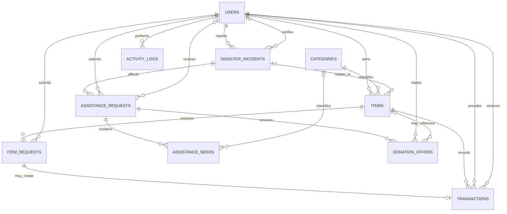

# Circlo ERD (Mermaid)

## Relationship notes

- `users` is the central account table.
- `items` belongs to one owner and one category. An item may optionally be linked to a disaster incident.
- `item_requests` connects a member requesting an item to that item.
- `transactions` records the result of an accepted item request.
- `disaster_incidents` can have many `assistance_requests`.
- `assistance_requests` can contain many `assistance_needs` and receive many `donation_offers`.
- `activity_logs` records actions and can remain even if an account is later removed; the actor reference becomes NULL.
